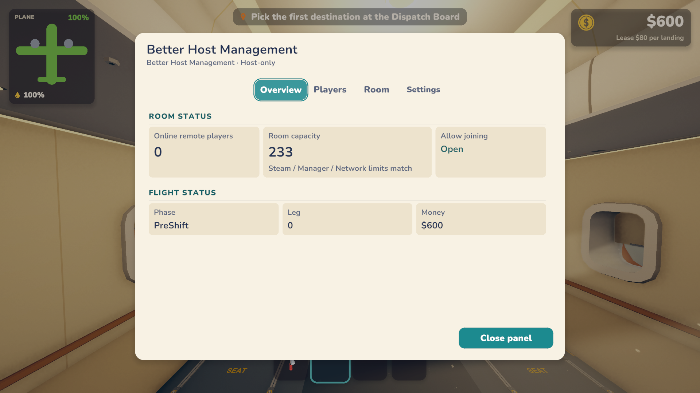
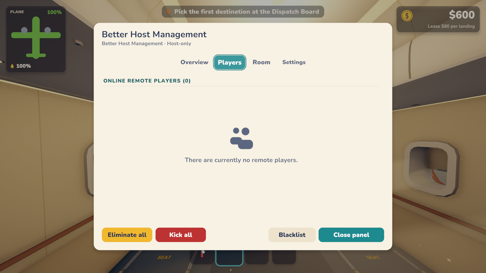
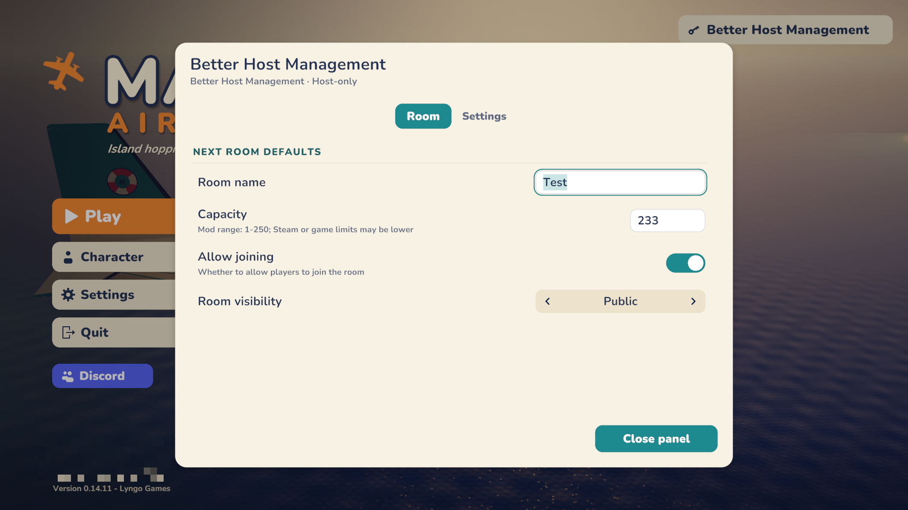
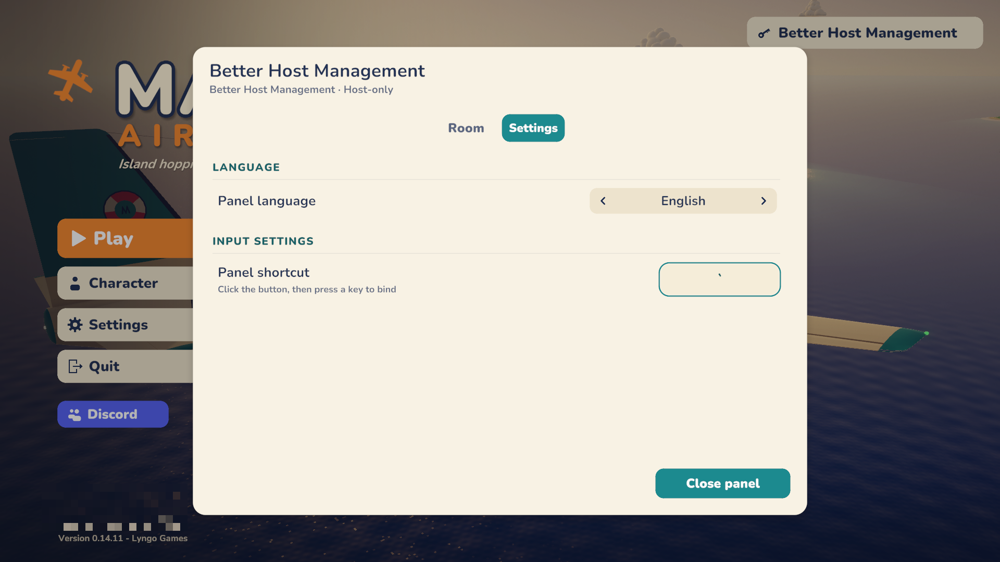

# Better Host Management 0.5.27

English | [简体中文](README.md)

> [!IMPORTANT]
> **Prerequisite:** This mod must be installed and enabled through [Mayday Mod Manager](https://github.com/LS3213/Mayday-Mod-Manager) by **lansi**. Install the Manager first, then add the `.maydaymod` via **MOD Management → Add MOD**. Copying the package into the game folder alone will not load it.

A host-management mod for **Mayday Airways**, built for **Mayday Mod Manager 1.2.6 / MelonLoader 0.7.3**. Only the player hosting the room needs the mod. Clients joining someone else's room do not need it and cannot open the management panel.

> Unofficial mod. Not affiliated with the game's developer or publisher. Read the Limitations section and comply with the game's terms and the licenses of MelonLoader, Harmony, and related projects.

## Screenshots

Screenshots use the English UI; the panel itself supports 11 languages.

<p align="center">
  
  
</p>
<p align="center">
  
  
</p>

## Features

- Native in-game UI; no HTTP server and no external web app.
- **Overview**: online remote players, room capacity, join permission, flight phase/leg/money.
- **Players**: kick, kick all, eliminate, eliminate all, revive all, ban/unban, Steam profile/add friend.
- **Room**: live room name, capacity 1–250, allow joining, Private/FriendsOnly/Public visibility.
- **Settings**: 11 panel languages and shortcut rebinding.
- **Lobby defaults**: save the next room's name, capacity, join permission, and visibility.
- The blacklist persists; management actions are logged.
- Flight-save code is retained, but the tab is hidden from navigation.

## Requirements

- Mayday Airways (current game/demo build).
- Mayday Mod Manager 1.2.6.
- MelonLoader 0.7.3.
- .NET 6 SDK (source builds only).
- Host only; do not install alongside the old BepInEx HostAdmin/Deep Save.

## Installation

1. Import `Mayday-Host-Control-0.5.27.maydaymod` with the Manager, enable it, and restart the game.
2. Create a room from the machine that has the mod installed.
3. Open the panel:
   - In a room: use the key icon "Better Host Management" next to "Invite friends" in the pause/captain menu.
   - Main lobby: use "Better Host Management" in the top-right; it opens "Next room defaults" by default.
   - Default shortcut: `F8`; rebind it on the Settings tab.
   - `Esc` closes the panel. When a room text field is focused, the first `Esc` ends editing and the second closes the panel.
4. Clients joining someone else's room cannot open the panel.

## Panel

### Overview

- **Room status**: online remote players, room capacity, allow joining. The capacity card compares the Steam Lobby, Manager, and Network limits.
- **Flight status**: phase, leg, money.
- When no Steam Lobby is active, the capacity card indicates that the current configuration is in use.

### Players

- Online remote players with avatar, name, and Alive/Eliminated/Not initialized state.
- Per-player actions: Steam profile, add friend, eliminate, revive, kick, ban.
- Footer bulk actions: Eliminate all, Kick all, **Revive all**, Blacklist, Close panel.
- "Revive all" appears only when at least one online remote player is eliminated. Its width is measured from the current language text, not fixed. The host is excluded from revival.
- The Blacklist window shows banned players, opens their profile, or unbans them.
- Bulk actions never affect the host.

### Room

- Room name (up to 48 characters).
- Capacity 1–250; Steam or the game may enforce a lower limit. Saves use the value actually accepted by the Steam Lobby.
- Allow joining: disabling it blocks new players while existing players stay connected. Re-enabling requires the recovery flow to be unlocked.
- Visibility: Invite only / Friends only / Public. Changes are applied to the Steam Lobby type immediately; propagation to external lists is handled by Steam.
- Save / Save and apply applies changes in order; failures are written to the log. 0.5.27 fixes a stale pending value when the visibility selector was switched away from and back to its original option.
- When opened from the lobby, this tab is "Next room defaults"; saved values are applied the next time a room is created.

### Settings

- Panel language: 简体中文, English, Français, Deutsch, Español, Português (Brasil), Türkçe, Русский, 日本語, 한국어, Polski. Changes apply immediately and are saved.
- Panel shortcut: click, then press a new key. `Esc` cancels.

### Flight saves (hidden)

- `Ground / ExactGround`: save after a stable stop with the parking brake engaged; restore on the ground.
- `Airborne / SafeOriginPreShift`: save host-authoritative economy, durability, resources, items, player assets, and kinematics; loading returns to the departure airport `PreShift` and cancels the current flight.
- Recovery is not a transaction rollback. A failure during the apply stage locks the current room; create a new room and retry.
- In-flight snapshots do not restore spawned passengers, airborne physics, or vanilla remote-client local actions such as climbing, ropes, or downed states.
- The Saves tab is hidden from navigation; the underlying data and code are retained.

## Data and privacy

- Data directory: `UserData/MaydayHostControl/` (configuration, blacklist, player tags, checkpoints, diagnostics).
- The mod reads legacy `BepInEx/config` data left in the game directory but never moves or deletes it.
- No HTTP server is started. Steam profile buttons open the Steam overlay or a browser link.
- Logs and diagnostic bundles may contain SteamIDs and player names; redact them before sharing.

## Building from source

You need the .NET 6 SDK and a game directory where MelonLoader has already generated `MelonLoader/Il2CppAssemblies`. The source repository does not contain game assemblies.

```powershell
.\build.ps1 -Game "C:\Path\To\Mayday Airways Demo"
.\verify.ps1 -Game "C:\Path\To\Mayday Airways Demo"
.\package.ps1 -Game "C:\Path\To\Mayday Airways Demo"
```

- `build.ps1` builds `src\bin\Release\net6.0\Mayday.HostControl.dll`; add `-Deploy` to copy it to the game's `Mods\MaydayPkg.mayday-host-control`.
- `verify.ps1` builds and validates the keys and placeholders for all 11 languages.
- `package.ps1` produces `dist\Mayday-Host-Control-0.5.27.maydaymod`.

## Repository layout

```text
.
├─ build.ps1 / verify.ps1 / package.ps1
├─ manifest.json
├─ README.md / README.en.md
└─ src/
   ├─ Plugin.cs / InGameGui.cs / PlayerCards.cs / PlayerModeration.cs
   ├─ Localization.cs / MelonCompat.cs / SmoothListScroll.cs / AdminWebPage.cs
   ├─ MaydayHostControl.csproj / admin.html
   └─ Locales/ (11 JSON files)
```

## 0.5.27 changes

- Fixed the stale pending visibility value when the selector was switched away from and back to its original option.
- Added "Revive all": shown when any online remote player is eliminated; width adapts to the localized label.
- Version bump.

## Limitations

- Game updates may break native UI or reflection calls.
- The panel releases the mouse but cannot guarantee that all flight input is blocked; pause the game or leave the seat before using it.
- Recovery is not a transaction rollback. A failed apply stage locks the room; create a new room and retry.
- Complete a real multiplayer round trip before relying on a unique save.
- Host only; clients joining another room have no management entry point.
- The Saves tab is currently hidden, but the related code remains.

## License

MIT License; see [LICENSE](LICENSE). MelonLoader, Harmony, Steamworks.NET, Mirror, and Unity are not bundled with this project; comply with their licenses and the game's terms.
