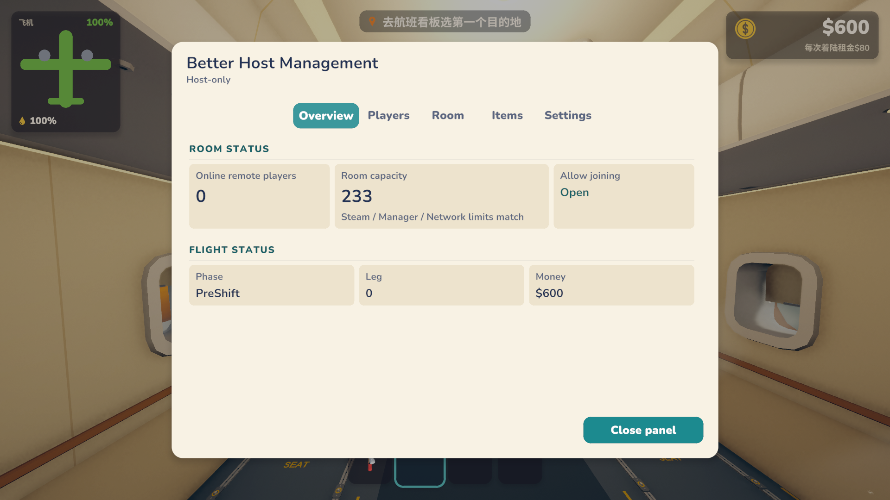
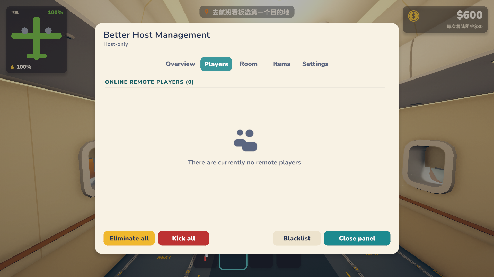
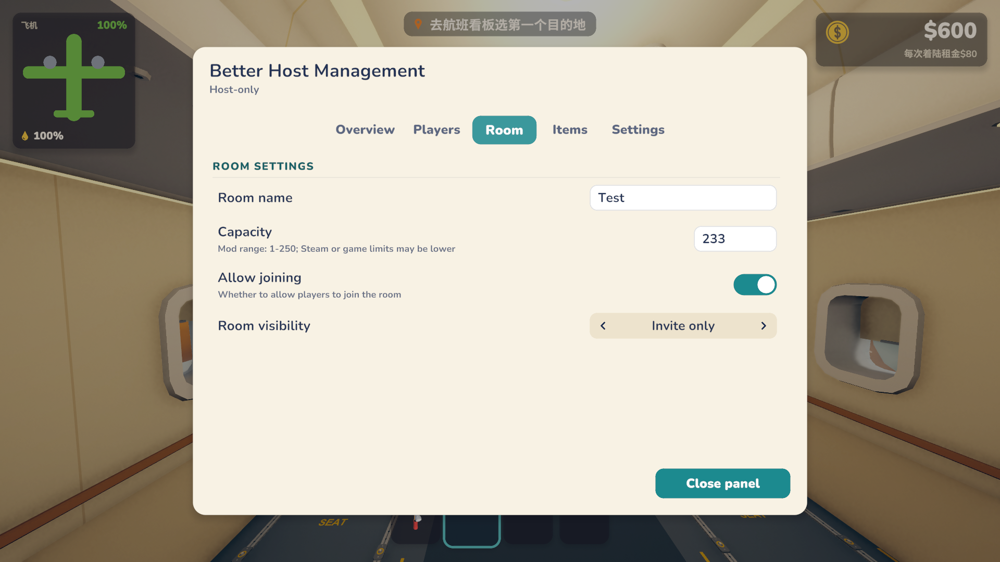
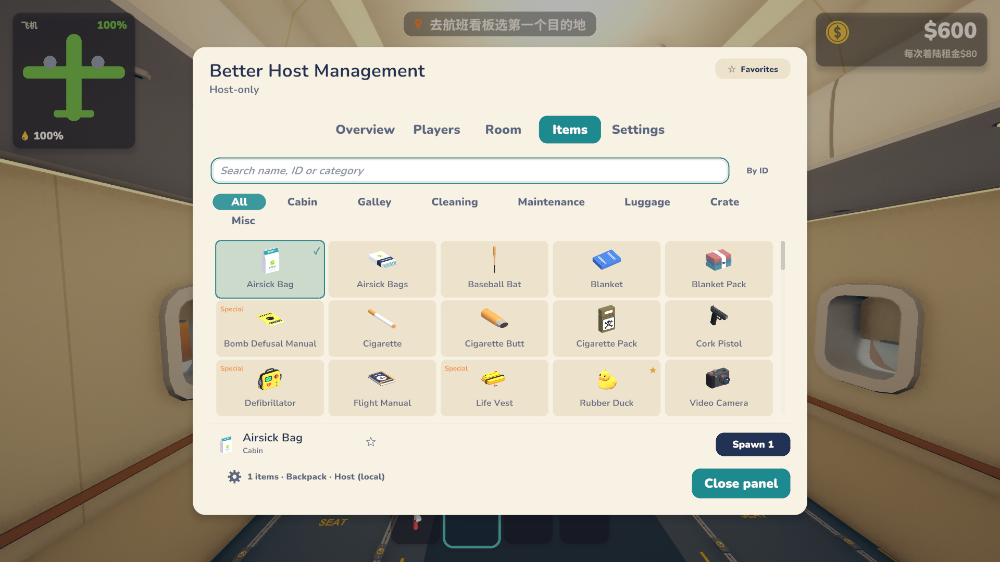
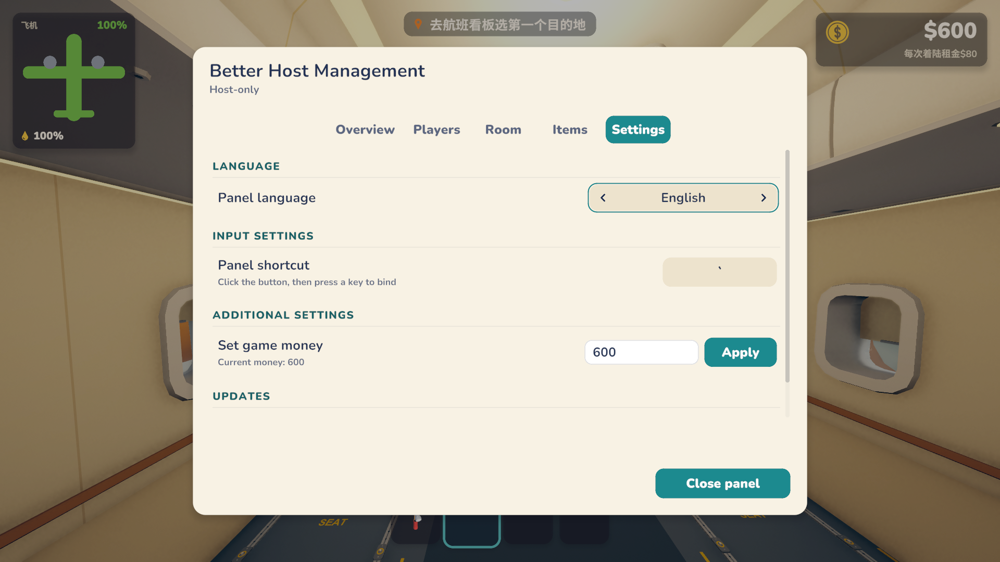

# Better Host Management 0.5.69

English | [简体中文](README.md)

> [!IMPORTANT]
> **Prerequisite:** This mod must be installed and enabled through [Mayday Mod Manager](https://github.com/LS3213/Mayday-Mod-Manager) by **lansi**. Install the Manager first, then add the `.maydaymod` via **MOD Management → Add MOD**. Copying the package into the game folder alone will not load it.

A host-management mod for **Mayday Airways**, built for **Mayday Mod Manager 1.2.6 / MelonLoader 0.7.3**. Only the player hosting the room needs the mod. Clients joining someone else's room do not need it and cannot open the management panel.

> Unofficial mod. Not affiliated with the game's developer or publisher. Read the Limitations section and comply with the game's terms and the licenses of MelonLoader, Harmony, and related projects.

## Screenshots

Screenshots use the **English** UI; the Chinese UI is shown in [简体中文](README.md). The panel supports 11 languages.

<p align="center">
  
  
</p>
<p align="center">
  
  
</p>
<p align="center">
  
</p>

## Features

- Native in-game UI; no web panel, no local HTTP server, no background services.
- **Overview**: online remote players, room capacity, join permission, flight phase/leg/money.
- **Players**: kick, kick all, eliminate, eliminate all, revive all, ban/unban, Steam profile/add friend.
- **Room**: live room name, capacity 1–250, allow joining, Private/FriendsOnly/Public visibility.
- **Items**: item grid, search by name/ID/category, spawn by ID, delivery settings (target player/quantity/backpack or ground), favourites and a favourites page.
- **Settings**: 11 panel languages, shortcut rebinding, and update checks against GitHub Releases.
- **Update check**: the host checks once when the Settings tab is first opened inside a room; afterwards only on demand. When a newer release exists the button turns red and opens that Release page in the default browser; nothing is downloaded or installed automatically.
- **Lobby defaults**: save the next room's name, capacity, join permission, and visibility.
- The blacklist persists; management actions are logged.
- Flight saves are not integrated yet; a future version may integrate lansi's Mayday Save.

## Requirements

- Mayday Airways (current game/demo build).
- Mayday Mod Manager 1.2.6.
- MelonLoader 0.7.3.
- .NET 6 SDK (source builds only).
- Host only; do not install alongside the old BepInEx HostAdmin/Deep Save.

## Installation

1. Import `Mayday-Host-Control-0.5.69.maydaymod` with the Manager, enable it, and restart the game.
2. Create a room from the machine that has the mod installed.
3. Open the panel:
   - In a room: use the key icon "Better Host Management" next to "Invite friends" in the pause/captain menu.
   - Main lobby: use "Better Host Management" in the top-right; it opens "Next room defaults" by default.
   - Default shortcut: `F8`; rebind it on the Settings tab.
   - `Esc` closes the panel. When a room text field is focused, the first `Esc` ends editing and the second closes the panel.
4. Clients joining someone else's room cannot open the panel.

## Panel

### Overview

- **Room status**: online remote players, room capacity, allow joining. The capacity card compares the Steam Lobby, Manager, and Network limits.
- **Flight status**: phase, leg, money.
- When no Steam Lobby is active, the capacity card indicates that the current configuration is in use.

### Players

- Online remote players with avatar, name, and Alive/Eliminated/Not initialized state.
- Per-player actions: Steam profile, add friend, eliminate, revive, kick, ban.
- Footer bulk actions: Eliminate all, Kick all, **Revive all**, Blacklist, Close panel.
- "Revive all" appears only when at least one online remote player is eliminated. Its width is measured from the current language text, not fixed. The host is excluded from revival.
- The Blacklist window shows banned players, opens their profile, or unbans them.
- Bulk actions never affect the host.

### Room

- Room name (up to 48 characters).
- Capacity 1–250; Steam or the game may enforce a lower limit. Saves use the value actually accepted by the Steam Lobby.
- Allow joining: disabling it blocks new players while existing players stay connected.
- Visibility: Invite only / Friends only / Public. Changes are applied to the Steam Lobby type immediately; propagation to external lists is handled by Steam.
- Save / Save and apply applies changes in order; failures are written to the log. Switching the visibility selector away from and back to its original option no longer leaves a stale pending value.
- When opened from the lobby, this tab is "Next room defaults"; saved values are applied the next time a room is created.

### Items

- The search box matches item names, item IDs, and category names. "By ID" on the right opens a prompt to spawn an arbitrary ID (special items need a second click to confirm).
- Category filters: All, Cabin, Galley, Cleaning, Maintenance, Luggage, Crate, Misc. The active filter is highlighted and hovering deepens its plate.
- The grid shows 5 items per row and scrolls with the wheel. A click selects an item; the dock shows its icon, name, and category.
- Dock actions: spawn 1 item (quantity is set in delivery settings), the delivery-settings entry (gear + current target/destination summary), and the favourite star.
- Delivery settings dialog: large icon and ID (click to copy), target player, quantity 1–99, destination (backpack or ground).
- Free backpack slots are checked before granting; anything that does not fit drops next to the target, and the result is reported in the dock.

### Favourites

- "☆ Favourites" in the top-right of the Items tab opens the favourites page; while it is open the button shows a filled ★.
- The star in the dock saves or removes the selected item, and the list persists in the local configuration.
- The favourites page lists saved items only: "< Items" returns to the full item page and the saved count sits on the right. An empty state explains how to add items.
- Search and category filters are hidden there so the saved set is not silently filtered.

### Settings

- Panel language: 简体中文, English, Français, Deutsch, Español, Português (Brasil), Türkçe, Русский, 日本語, 한국어, Polski. Changes apply immediately and are saved.
- Panel shortcut: click, then press a new key. `Esc` cancels.

### Updates

- The row shows the current version; the button cycles through `Check for updates` → `Checking…` → `Up to date` / `New version x.y.z` (red) / `No release published yet` / `Check failed · Retry`.
- **Automatic check**: the host checks once the first time the Settings tab is opened inside a room on this machine (once per game session); later visits do not auto-check.
- **Manual check**: click the button at any time. It is disabled while a check is running so requests cannot pile up.
- When a newer release exists the button turns red; clicking it opens the GitHub Release page in the default browser. The mod never downloads, replaces files, or installs silently — Mod Manager still owns updates.
- Version source: `tag_name` from `GET https://api.github.com/repos/ChEnLeo-7/Mayday-Host-Control/releases/latest`, compared as `x.y.z` against the local version. Release tags use `v<version>` (for example `v0.5.69`).
- Requests time out after 6 seconds; offline, rate-limited, or not-yet-published cases are reported in the row only and never block the rest of the panel.

### Flight saves (not included yet)

This version does **not** provide flight saves or restoration, and the Saves tab is not shown. The legacy save code is no longer documented as part of this release's supported feature set.

A future version may integrate or support **lansi**'s [Mayday Save](https://github.com/LS3213/Mayday-Mod-Manager/tree/main/mods/mayday-save). Until then, install lansi's save mod separately if you need save/restore, and check version compatibility between the two mods; do not rely on two uncoordinated save paths at the same time.

## Data and privacy

- Data directory: `UserData/MaydayHostControl/` (configuration, blacklist, player tags, legacy checkpoints, diagnostics).
- The mod reads legacy `BepInEx/config` data left in the game directory but never moves or deletes it.
- No local HTTP server is started. Steam profile buttons open the Steam overlay or a browser link.
- The update check only requests the latest Release from `api.github.com` (the request carries a User-Agent and the local version); no SteamIDs, player names, or local files are uploaded, and nothing is sent when the check is not run.
- Logs and diagnostic bundles may contain SteamIDs and player names; redact them before sharing.

## Building from source

You need the .NET 6 SDK and a game directory where MelonLoader has already generated `MelonLoader/Il2CppAssemblies`. The source repository does not contain game assemblies.

```powershell
.\build.ps1 -Game "C:\Path\To\Mayday Airways Demo"
.\verify.ps1 -Game "C:\Path\To\Mayday Airways Demo"
.\package.ps1 -Game "C:\Path\To\Mayday Airways Demo"
```

- `build.ps1` builds `src\bin\Release\net6.0\Mayday.HostControl.dll`; add `-Deploy` to copy it to the game's `Mods\MaydayPkg.mayday-host-control`.
- `verify.ps1` builds and validates the keys and placeholders for all 11 languages.
- `package.ps1` reads the version from `manifest.json` and produces `dist\Mayday-Host-Control-<version>.maydaymod` (currently `0.5.69`), then prints its SHA256.

## Repository layout

```text
.
├─ build.ps1 / verify.ps1 / package.ps1
├─ manifest.json
├─ README.md / README.en.md
└─ src/
   ├─ Plugin.cs / InGameGui.cs / ItemBrowser.cs / ItemNameLocalization.cs
   ├─ PlayerCards.cs / PlayerModeration.cs
   ├─ Localization.cs / MelonCompat.cs / SmoothListScroll.cs
   ├─ MaydayHostControl.csproj
   └─ Locales/ (11 JSON files)
```

## Changelog

### 0.5.69

- Fixed the outline that appeared around the update button after a click by removing its focus ring.
- Screenshots are now split by language: the Chinese README uses Chinese UI shots, the English one uses English UI shots, and both now include the Items tab.

### 0.5.68

- Added **Check for updates**: a new Updates section on the Settings tab compares the latest GitHub Release with the local version.
- The host checks once when the Settings tab is first opened inside a room; afterwards only manual clicks trigger a check.
- When a newer release exists the button turns red with `New version x.y.z`; clicking it opens that Release page in the default browser. Nothing is downloaded or installed.
- Timeouts, offline, rate limits, and missing releases are reported in the row only and never block the rest of the panel.

### 0.5.67 (changes since 0.5.27)

- Added the **Items** tab: item grid, search by name/ID/category, spawn by ID, and delivery settings (target player, quantity, backpack or ground).
- Added favourites: items can be starred, a dedicated favourites page lists them, and the list persists in the local configuration.
- Item names are localized with the panel language; unknown items fall back to the game name or the raw ID.
- UI polish: deeper hover plate on category chips, the delivery-settings entry lost its background and only appears on the Items tab, and the favourite star uses the game's own icon and is centred.
- Removed the legacy web-admin leftovers: `admin.html`, `AdminWebPage.cs`, and the unused `HttpListener` server, `/api/*` handlers, request models, and status-snapshot cache in `Plugin.cs` (about 300 lines). That web panel never started in the Manager-era build, so panel features and in-game behaviour are unchanged, and the per-refresh status JSON serialization is gone.

### 0.5.27

- Fixed the stale pending visibility value when the selector was switched away from and back to its original option.
- Added "Revive all": shown when any online remote player is eliminated; width adapts to the localized label.
- Version bump.

## Limitations

- Game updates may break native UI or reflection calls.
- The panel releases the mouse but cannot guarantee that all flight input is blocked; pause the game or leave the seat before using it.
- Host only; clients joining another room have no management entry point.
- Flight saves are not available in this version; use lansi's Mayday Save if needed.

## License

MIT License; see [LICENSE](LICENSE). MelonLoader, Harmony, Steamworks.NET, Mirror, and Unity are not bundled with this project; comply with their licenses and the game's terms.
