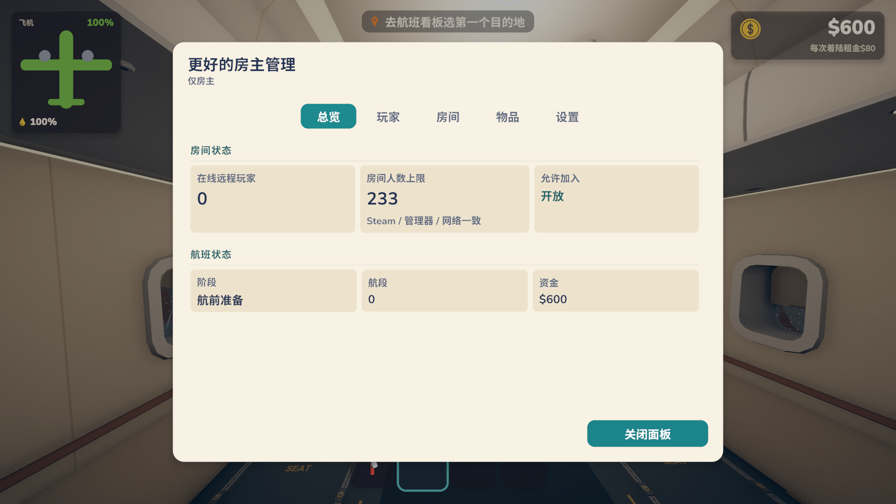
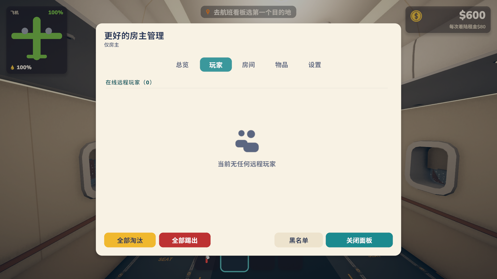
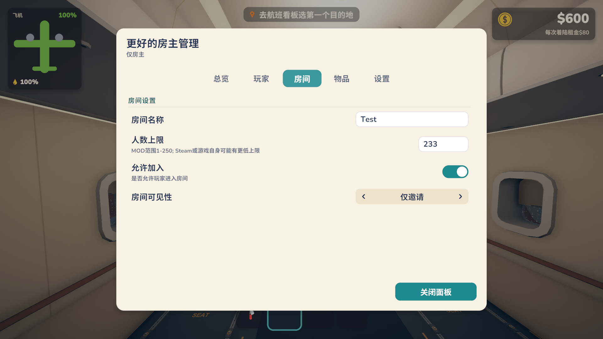
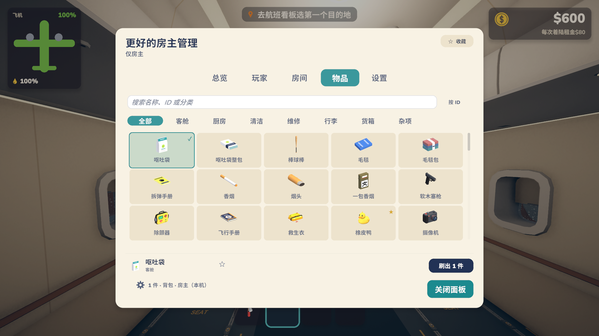
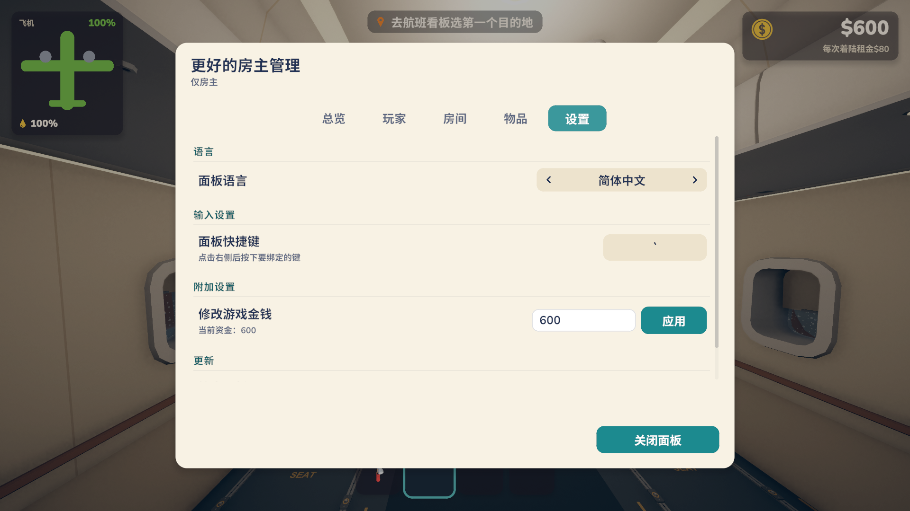

# 更好的房主管理 0.6.0

[English](README.en.md) | 简体中文

> [!IMPORTANT]
> **安装前置：** 本 Mod 必须通过 [Mayday 模组管理器](https://github.com/LS3213/Mayday-Mod-Manager)（作者 **lansi**）安装并启用。请先安装管理器，再在游戏主菜单的 **MOD 管理 → 添加 MOD** 中导入 `.maydaymod`；只把包文件放进游戏目录不会加载。

面向 **Mayday Mod Manager 1.2.6 / MelonLoader 0.7.3** 的房主管理 Mod。房主安装后可管理房间；加入他人房间的成员如果也安装，可打开面板使用本地功能（总览、语言/快捷键/更新检查、游戏内相机/HUD、房员广播等），但踢人、刷物品、房间设置等房主操作仍不可用。

> 非官方 Mod，与游戏开发商/发行商无关。使用前请阅读“限制”，并遵守游戏及 MelonLoader、Harmony 等相关条款。

## 界面预览

以下为**简体中文**界面截图；英文界面见 [English](README.en.md)。面板共支持 11 种语言。

<p align="center">
  
  
</p>
<p align="center">
  
  
</p>
<p align="center">
  
</p>

## 功能

- 游戏内原生 UI；无网页端、无本地 HTTP 服务、无外部依赖。
- **总览**：在线远程玩家、房间容量、允许加入、航班阶段/航段/资金。
- **玩家**：踢出、全部踢出、淘汰、全部淘汰、一键复活、拉黑/解除、Steam 资料/加好友。
- **房间**：实时房间名、容量 1-250、允许加入、Private/FriendsOnly/Public 可见性。
- **物品**：物品网格、按名称/ID/分类搜索、按 ID 刷出、发放设置（目标玩家/数量/背包或地面）、收藏与收藏页。
- **设置**：11 种面板语言、快捷键重绑定、检查更新（读取 GitHub Releases）。
- **相机与 HUD**：第三人称、自由相机、HUD 隐藏和相机/玩家控制切换；玩家在飞机驾驶位或机场地面载具上时，相机跟随对应对象。
- **更新检查**：房主首次在房间内打开“设置”页时自动检查一次；之后只能手动点击。发现新版本时按钮变红，点击用默认浏览器打开对应 Release 页面，不自动下载或安装。
- **大厅预设**：保存下次开房的名称、容量、允许加入和可见性。
- **房员模式**：非房主成员安装后可打开面板的“总览 / 设置”，使用本地相机/HUD/标点、语言和快捷键等。房员广播（F9）优先通过房主转发；若房主是未安装 Mod 的原版游戏，则自动改用原版标点文字：文字会作为 40 字以内的标点标签显示给房间内所有玩家，包括房主和未安装 Mod 的玩家。玩家/房间/物品页与房主权限操作仍关闭。
- 黑名单持久化；管理操作写入日志。
- 航班存档暂未集成；未来可能整合 lansi 的存档管理。

## 环境要求

- Mayday Airways（当前游戏/Demo 版本）。
- Mayday Mod Manager 1.2.6。
- MelonLoader 0.7.3。
- .NET 6 SDK（仅从源码构建时需要）。
- 房主安装用于房间管理；房员安装可使用本地功能（房主权限操作仍不可用）。不要同时安装旧 BepInEx HostAdmin/Deep Save。

## 安装

1. 通过 Manager 导入 `Mayday-Host-Control-0.6.0.maydaymod`，启用并重启游戏。
2. 由安装 Mod 的玩家创建房间；房员也需要安装才能打开本地功能页。
3. 打开入口：
   - 房间内：暂停菜单（机长菜单）中“邀请好友”旁的钥匙图标“更好的房主管理”。
   - 大厅主菜单：右上角“更好的房主管理”，默认进入“下次开房设置”。
   - 默认快捷键 `F8`，可在“设置”页重绑定。
   - `Esc` 关闭；房间输入框聚焦时，第一次 `Esc` 结束编辑，第二次关闭面板。
4. 加入他人房间的房员：安装后可打开面板，默认只显示“总览 / 设置”；“玩家 / 房间 / 物品”页和房主权限操作不可用。房员广播（F9）在房主装有 0.5.167+ 时走房主转发；房主是原版/旧版时自动改为原版标点文字，无需房主安装 Mod。标点文字是 40 字以内的世界标点，约 7 秒消失，最多同时 8 条，不是聊天记录。

## 面板

### 总览

- **房间状态**：在线远程玩家、房间容量、允许加入；容量卡片会对比 Steam Lobby、Manager、Network 三处上限。
- **航班状态**：阶段、航段、资金。
- 不在 Steam Lobby 中时，容量卡片会提示使用当前配置。

### 玩家

- 在线远程玩家列表：头像、名称、存活/淘汰/未初始化状态。
- 单人操作：Steam 资料、加好友、淘汰、复活、踢出、拉黑。
- 底部批量操作：全部淘汰、全部踢出、**全部复活**、黑名单、关闭面板。
- “全部复活”只在至少一名在线远程玩家处于淘汰状态时出现；按钮宽度按当前语言文本测量，不固定；房主自身不在复活范围内。
- 黑名单窗口可查看记录、打开资料页或解除拉黑。
- 批量操作不会影响房主自身。

### 房间

- 房间名称（最多 48 个字符）。
- 人数上限 1-250；Steam 或游戏自身可能有更低上限，保存时以 Steam Lobby 实际接受值为准。
- 允许加入：关闭后新玩家不能进入，已在房间内的玩家不受影响。
- 可见性：仅邀请 / 仅好友 / 公开。实时修改 Steam Lobby 类型，外部列表传播由 Steam 完成。
- 保存 / 保存并应用会依次应用修改；失败项写入日志。可见性选择器回切原选项时不会保留错误的待保存值。
- 在大厅打开时为“下次开房设置”，保存后写入本地配置，下次创建房间时应用。

### 物品

- 搜索框匹配物品名称、物品 ID 与分类名；右侧“按 ID”可直接输入 ID 刷出（特殊物品需再点一次确认）。
- 分类筛选：全部、客舱、厨房、清洁、维修、行李、货箱、杂项；选中项高亮，悬浮时底色加深。
- 物品网格每行 5 个，滚轮滚动；单击选中，底部栏显示物品图标、名称与分类。
- 底部操作：刷出 1 件（数量在发放设置里调整）、发放设置入口（齿轮 + 当前目标/投放摘要）、收藏星标。
- 发放设置弹窗：物品大图与 ID（点击复制）、目标玩家、数量 1-99、投放位置（背包/地面）。
- 发放前检查目标背包空位；背包放不下的部分掉落在目标旁边，结果回显在底部栏。

### 收藏

- 物品页右上角“☆ 收藏”进入收藏页；在收藏页内按钮显示为实心 ★。
- 底部栏星标可收藏/取消收藏当前物品，收藏结果持久化到本地配置。
- 收藏页只列出已收藏物品：左上返回完整物品页，右上显示已收藏数量；空收藏时显示提示。
- 收藏页没有搜索与分类筛选，避免与收藏集合混淆。

### 设置

- 面板语言：简体中文、English、Français、Deutsch、Español、Português (Brasil)、Türkçe、Русский、日本語、한국어、Polski。切换即时生效并保存。
- 面板快捷键：点击后按下新键绑定，`Esc` 取消。

### 更新

- 行内显示当前版本，右侧按钮依次表示：`检查更新` → `检查中…` → `已是最新` / `新版本 x.y.z`（红色）/ `尚未发布 Release` / `检查失败 · 重试`。
- **自动检查**：房主在本机房间内首次打开“设置”页时自动查一次（每个游戏会话只触发一次）；之后再打开不会自动查。
- **手动检查**：随时点击按钮；检查期间按钮禁用，避免重复请求。
- 有新版本时按钮变红，点击用默认浏览器打开 GitHub Release 页面；本 Mod 不下载、不替换文件、不静默安装，更新仍由 Mod Manager 负责。
- 版本来源：`GET https://api.github.com/repos/ChEnLeo-7/Mayday-Host-Control/releases/latest` 的 `tag_name`，取其中的 `x.y.z` 与本地版本比较；Release tag 统一使用 `v<版本>`（如 `v0.6.0`）。
- 请求超时 6 秒；无网络、限流或尚无 Release 都只会在行内提示，不影响面板其它功能。

### 存档功能（暂未集成）

当前版本**不提供**航班存档/恢复功能，导航中也没有存档页；旧存档相关代码不再作为本版本的功能对外说明。

未来版本可能会整合或兼容 **lansi** 的 [存档管理（Mayday Save）](https://github.com/LS3213/Mayday-Mod-Manager/tree/main/mods/mayday-save)。在整合完成前，如需保存/恢复航班，请直接安装并使用 lansi 的存档模组，并留意两个模组的版本与兼容说明；不要同时依赖两套未协调的存档逻辑。

## 数据与隐私

- 数据目录：`UserData/MaydayHostControl/`，包含配置、黑名单、玩家标签、历史检查点和诊断包。
- 插件只读检查仍留在游戏目录中的旧 `BepInEx/config` 存档，不移动、不删除。
- 不启动任何本地 HTTP 服务；Steam 资料按钮会打开 Steam Overlay 或浏览器链接。
- 检查更新只会向 `api.github.com` 请求最新 Release（请求头里只有 User-Agent 与本地版本号），不上传 SteamID、玩家名或任何本地文件；不检查时不发起任何网络请求。
- 日志和诊断包可能包含 SteamID、玩家名；分享前请自行脱敏。

## 从源码构建

需要 .NET 6 SDK，以及已由 MelonLoader 首次启动生成 `MelonLoader/Il2CppAssemblies` 的游戏目录。源码仓库不包含游戏程序集。

```powershell
.\build.ps1 -Game "C:\Path\To\Mayday Airways Demo"
.\verify.ps1 -Game "C:\Path\To\Mayday Airways Demo"
.\package.ps1 -Game "C:\Path\To\Mayday Airways Demo"
```

- `build.ps1` 编译到 `src\bin\Release\net6.0\Mayday.HostControl.dll`；加 `-Deploy` 会复制到游戏的 `Mods\MaydayPkg.mayday-host-control`。
- `verify.ps1` 构建并校验 11 种语言的键和占位符。
- `package.ps1` 读取 `manifest.json` 的版本号，生成 `dist\Mayday-Host-Control-<版本>.maydaymod`（当前为 `0.6.0`），并输出 SHA256。

## 仓库结构

```text
.
├─ build.ps1 / verify.ps1 / package.ps1
├─ manifest.json
├─ README.md / README.en.md
└─ src/
   ├─ Plugin.cs / InGameGui.cs / ItemBrowser.cs / ItemNameLocalization.cs
   ├─ PlayerCards.cs / PlayerModeration.cs
   ├─ Localization.cs / MelonCompat.cs / SmoothListScroll.cs
   ├─ MaydayHostControl.csproj
   └─ Locales/（11 个 JSON）
```

## 更新记录

### 0.6.0 更新内容

- 新增第三人称和自由相机：飞机驾驶位使用飞机跟随镜头，机场行李牵引车等地面载具使用对应车辆镜头，普通状态使用玩家镜头。
- 修复自由相机退出后偶发的第一人称视角错误，退出时恢复相机朝向和进入自由相机前保存的视图状态。
- 新增自由相机中的玩家控制切换、HUD 隐藏和相机自由观察支持。
- 扩展房员本地功能和标记广播：成员可使用总览、设置以及本地相机、HUD、标记和广播功能，房主权限仍按房间身份控制。
- 整合玩家、房间、物品管理和多语言界面更新，完善版本检查、构建验证与 0.6.0 发布包流程。

### 0.5.68

- 新增“检查更新”：设置页新增“更新”分区，读取 GitHub Releases 的最新版本并与本地版本比较。
- 房主首次在房间内打开设置页时自动检查一次；之后仅在手动点击时检查。
- 有新版本时按钮变红并显示 `新版本 x.y.z`，点击用默认浏览器打开对应 Release 页面；不自动下载或安装。
- 请求超时、无网络、限流或尚无 Release 都会在行内提示，不影响面板其它功能。

### 0.5.67（相对 0.5.27 的主要变化）

- 新增“物品”页：物品网格、名称/ID/分类搜索、按 ID 刷出、发放设置（目标玩家/数量/背包或地面）。
- 新增收藏：物品可收藏，收藏页集中查看，结果持久化到本地配置。
- 物品名称随面板语言本地化；未知物品回退为游戏原名或 ID。
- 界面细节：分类标签悬浮底色加深、发放设置入口去掉底板且只在物品页显示、收藏星标改用原生图标并居中。
- 移除旧版网页管理端遗留代码：删除 `admin.html`、`AdminWebPage.cs`，以及 `Plugin.cs` 中未启用的 `HttpListener` 监听、`/api/*` 处理、请求模型与状态快照缓存（合计约 300 行）。该网页端在 Manager 版本中从未启动，面板功能与游戏内行为不变，同时去掉了每次 UI 刷新时的状态 JSON 序列化开销。

### 0.5.27

- 修复房间可见性选择器回切原选项后仍保留错误待保存值的问题。
- 新增“全部复活”按钮：任一在线远程玩家被淘汰时显示，宽度按语言自适应。
- 版本号更新。

## 限制

- 游戏更新可能导致原生 UI/反射调用失效。
- 面板会释放鼠标，但不能保证拦截游戏全部飞行输入；操作前应暂停游戏或离开驾驶位。
- 房主可打开全部页面；房员安装后可打开“总览 / 设置”（仅本地功能），玩家/房间/物品页及房主权限操作不可用。房主无 Mod 时房员文字只能走原版标点标签，不是真正的全屏聊天。
- 当前版本不提供存档功能；如需保存/恢复，请使用 lansi 的存档模组。

## 爱发电

- https://afdian.com/a/mutterdeyu?utm_source=copylink&utm_medium=link

## 许可证

本项目使用 MIT License，见 [LICENSE](LICENSE)。MelonLoader、Harmony、Steamworks.NET、Mirror、Unity 等第三方组件不随本项目分发；使用或分发前请遵守各自许可及游戏条款。
