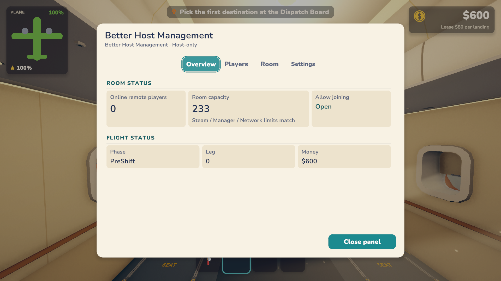
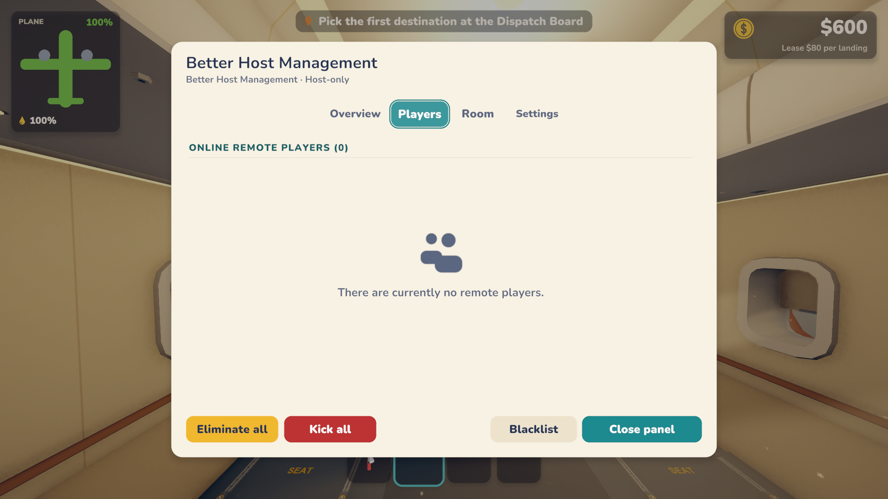
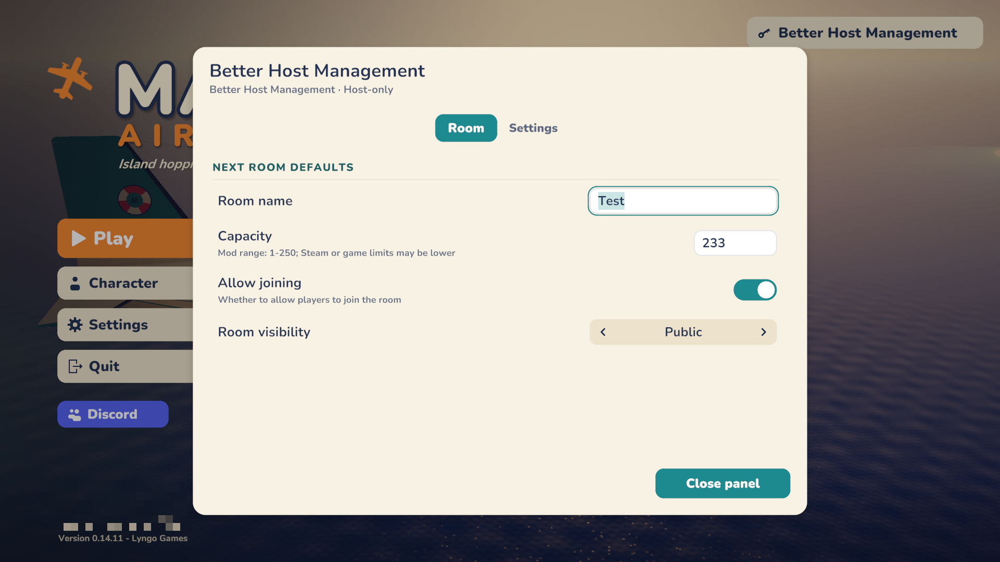
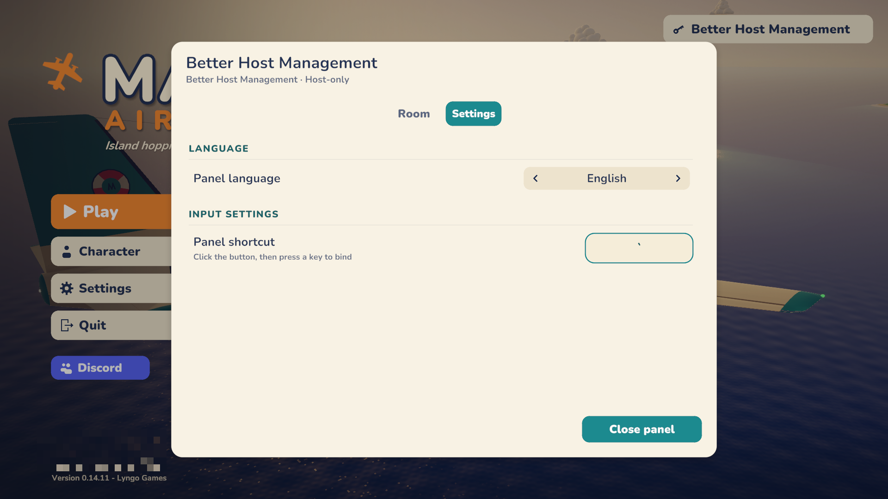

# 更好的房主管理 0.5.27

[English](README.en.md) | 简体中文

面向 **Mayday Mod Manager 1.2.6 / MelonLoader 0.7.3** 的房主管理 Mod。只有创建房间的房主需要安装；加入他人房间的客户端不需要安装，也无法打开管理面板。

> 非官方 Mod，与游戏开发商/发行商无关。使用前请阅读“限制”，并遵守游戏及 MelonLoader、Harmony 等相关条款。

## 界面预览

以下截图使用英文界面；面板本身支持 11 种语言。

<p align="center">
  
  
</p>
<p align="center">
  
  
</p>

## 功能

- 游戏内原生 UI，不启动 HTTP 服务，不依赖外部网页。
- **总览**：在线远程玩家、房间容量、允许加入、航班阶段/航段/资金。
- **玩家**：踢出、全部踢出、淘汰、全部淘汰、一键复活、拉黑/解除、Steam 资料/加好友。
- **房间**：实时房间名、容量 1-250、允许加入、Private/FriendsOnly/Public 可见性。
- **设置**：11 种面板语言、快捷键重绑定。
- **大厅预设**：保存下次开房的名称、容量、允许加入和可见性。
- 黑名单持久化；管理操作写入日志。
- 航班存档底层保留，当前导航中隐藏。

## 环境要求

- Mayday Airways（当前游戏/Demo 版本）。
- Mayday Mod Manager 1.2.6。
- MelonLoader 0.7.3。
- .NET 6 SDK（仅从源码构建时需要）。
- 仅房主安装；不要同时安装旧 BepInEx HostAdmin/Deep Save。

## 安装

1. 通过 Manager 导入 `Mayday-Host-Control-0.5.27.maydaymod`，启用并重启游戏。
2. 由安装 Mod 的玩家创建房间。
3. 打开入口：
   - 房间内：暂停菜单（机长菜单）中“邀请好友”旁的钥匙图标“更好的房主管理”。
   - 大厅主菜单：右上角“更好的房主管理”，默认进入“下次开房设置”。
   - 默认快捷键 `F8`，可在“设置”页重绑定。
   - `Esc` 关闭；房间输入框聚焦时，第一次 `Esc` 结束编辑，第二次关闭面板。
4. 加入他人房间的客户端不能打开管理面板。

## 面板

### 总览

- **房间状态**：在线远程玩家、房间容量、允许加入；容量卡片会对比 Steam Lobby、Manager、Network 三处上限。
- **航班状态**：阶段、航段、资金。
- 不在 Steam Lobby 中时，容量卡片会提示使用当前配置。

### 玩家

- 在线远程玩家列表：头像、名称、存活/淘汰/未初始化状态。
- 单人操作：Steam 资料、加好友、淘汰、复活、踢出、拉黑。
- 底部批量操作：全部淘汰、全部踢出、**全部复活**、黑名单、关闭面板。
- “全部复活”只在至少一名在线远程玩家处于淘汰状态时出现；按钮宽度按当前语言文本测量，不固定；房主自身不在复活范围内。
- 黑名单窗口可查看记录、打开资料页或解除拉黑。
- 批量操作不会影响房主自身。

### 房间

- 房间名称（最多 48 个字符）。
- 人数上限 1-250；Steam 或游戏自身可能有更低上限，保存时以 Steam Lobby 实际接受值为准。
- 允许加入：关闭后新玩家不能进入，已在房间内的玩家不受影响；重新开放需要恢复流程未锁定。
- 可见性：仅邀请 / 仅好友 / 公开。实时修改 Steam Lobby 类型，外部列表传播由 Steam 完成。
- 保存 / 保存并应用会依次应用修改；失败项写入日志。0.5.27 修复了可见性选择器回切原选项后仍保留错误待保存值的问题。
- 在大厅打开时为“下次开房设置”，保存后写入本地配置，下次创建房间时应用。

### 设置

- 面板语言：简体中文、English、Français、Deutsch、Español、Português (Brasil)、Türkçe、Русский、日本語、한국어、Polski。切换即时生效并保存。
- 面板快捷键：点击后按下新键绑定，`Esc` 取消。

### 存档（暂时隐藏）

- `Ground / ExactGround`：停稳并拉起停车刹车后保存，按地面状态恢复。
- `Airborne / SafeOriginPreShift`：保存主机权威经营、耐久、资源、物品、玩家资产和运动学；读取时返回起飞机场 `PreShift`，取消原航班。
- 恢复不是事务回滚；应用阶段失败会锁定当前房间，需要重建房间。
- 飞行安全快照不会恢复已生成乘客、空中原位物理或原版远程客户端的攀爬/绳索/倒地等本地动作。
- 当前导航不显示存档页；底层数据和代码保留。

## 数据与隐私

- 数据目录：`UserData/MaydayHostControl/`，包含配置、黑名单、玩家标签、检查点和诊断包。
- 插件只读检查仍留在游戏目录中的旧 `BepInEx/config` 存档，不移动、不删除。
- 不启动 HTTP 服务；Steam 资料按钮会打开 Steam Overlay 或浏览器链接。
- 日志和诊断包可能包含 SteamID、玩家名；分享前请自行脱敏。

## 从源码构建

需要 .NET 6 SDK，以及已由 MelonLoader 首次启动生成 `MelonLoader/Il2CppAssemblies` 的游戏目录。源码仓库不包含游戏程序集。

```powershell
.\build.ps1 -Game "C:\Path\To\Mayday Airways Demo"
.\verify.ps1 -Game "C:\Path\To\Mayday Airways Demo"
.\package.ps1 -Game "C:\Path\To\Mayday Airways Demo"
```

- `build.ps1` 编译到 `src\bin\Release\net6.0\Mayday.HostControl.dll`；加 `-Deploy` 会复制到游戏的 `Mods\MaydayPkg.mayday-host-control`。
- `verify.ps1` 构建并校验 11 种语言的键和占位符。
- `package.ps1` 生成 `dist\Mayday-Host-Control-0.5.27.maydaymod`。

## 仓库结构

```text
.
├─ build.ps1 / verify.ps1 / package.ps1
├─ manifest.json
├─ README.md / README.en.md
└─ src/
   ├─ Plugin.cs / InGameGui.cs / PlayerCards.cs / PlayerModeration.cs
   ├─ Localization.cs / MelonCompat.cs / SmoothListScroll.cs / AdminWebPage.cs
   ├─ MaydayHostControl.csproj / admin.html
   └─ Locales/（11 个 JSON）
```

## 0.5.27 更新

- 修复房间可见性选择器回切原选项后仍保留错误待保存值的问题。
- 新增“全部复活”按钮：任一在线远程玩家被淘汰时显示，宽度按语言自适应。
- 版本号更新。

## 限制

- 游戏更新可能导致原生 UI/反射调用失效。
- 面板会释放鼠标，但不能保证拦截游戏全部飞行输入；操作前应暂停游戏或离开驾驶位。
- 恢复不是事务回滚；应用阶段失败会锁定当前房间，必须重建房间重试。
- 使用唯一存档前必须先完成实际多人往返验证。
- 仅房主可打开；加入他人房间的客户端没有管理入口。
- 存档页当前隐藏，相关代码仍保留。

## 许可证

本项目使用 MIT License，见 [LICENSE](LICENSE)。MelonLoader、Harmony、Steamworks.NET、Mirror、Unity 等第三方组件不随本项目分发；使用或分发前请遵守各自许可及游戏条款。
