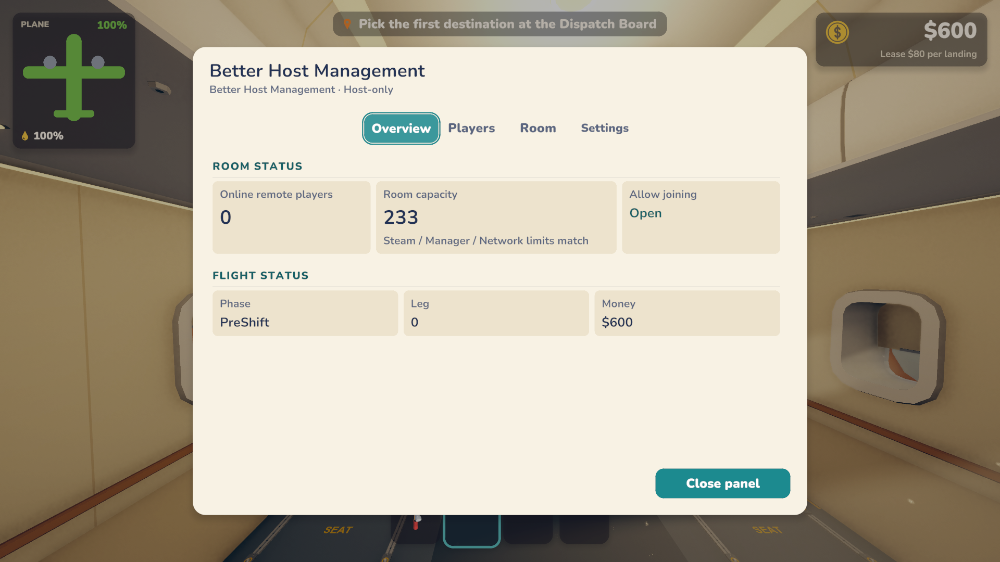

# 更好的房主管理 0.5.27 / Better Host Management 0.5.27

A host-side management mod for **Mayday Airways**. / 面向 **Mayday Airways** 的房主管理 Mod。

> **Prerequisite / 安装前置:** Install [Mayday Mod Manager](https://github.com/LS3213/Mayday-Mod-Manager) by **lansi** first. / 请先安装 **lansi** 制作的 [Mayday 模组管理器](https://github.com/LS3213/Mayday-Mod-Manager)。

## 中文

### 0.5.27 更新

- **全部复活**：任一在线远程玩家处于淘汰状态时出现；将全部被淘汰的远程玩家复活到房主位置。房主需存活，房主自身不在此按钮范围内。
- **修复房间可见性**：选择器切走再切回原选项后，不再保留错误的待保存值。
- 版本号更新至 **0.5.27**。

### 主要功能

- 房间实时管理：房间名称、人数上限 1–250（受 Steam 实际限制）、允许加入、仅邀请 / 仅好友 / 公开。
- 玩家管理：Steam 资料、加好友、淘汰、复活、踢出、拉黑；全部淘汰、全部踢出、全部复活。
- 黑名单、总览、下次开房设置、可自定义快捷键（默认 `F8`）。
- 11 种语言：简体中文、English、Français、Deutsch、Español、Português (Brasil)、Türkçe、Русский、日本語、한국어、Polski。
- 原生游戏内 UI，不启动 HTTP 服务。

### 安装

1. 安装 **Mayday 模组管理器**（1.2.6 / MelonLoader 0.7.3）。
2. 游戏主菜单 → **MOD 管理** → **添加 MOD** → 选择 `Mayday-Host-Control-0.5.27.maydaymod`。
3. 启用并 **重启游戏**。

### 兼容与限制

- 仅房主需要安装；加入他人房间的客户端不需要。
- 不要同时安装旧 BepInEx HostAdmin / Deep Save。
- 当前版本不提供存档功能；未来可能整合 lansi 的 [存档管理](https://github.com/LS3213/Mayday-Mod-Manager/tree/main/mods/mayday-save)。
- 游戏更新可能影响原生 UI 或反射调用。

### 下载

- 附件：`Mayday-Host-Control-0.5.27.maydaymod`
- SHA256：`56E432051907DFD92491403F36BCBC31A1FA4D742F2A311DD3AAAAA6F69DA9BB`
- GitHub：https://github.com/ChEnLeo-7/Mayday-Host-Control
- 问题反馈：https://github.com/ChEnLeo-7/Mayday-Host-Control/issues
- 许可证：MIT

---

## English

### What's new in 0.5.27

- **Revive All** — appears when any online remote player is eliminated; revives every eliminated remote player at the host's position. The host must be alive and is not included.
- **Room visibility fix** — switching away from and back to the original option no longer leaves a stale pending value.
- Version bumped to **0.5.27**.

### Features

- Live room controls: name, capacity 1–250 (subject to Steam limits), allow joining, Invite only / Friends only / Public.
- Player tools: Steam profile, add friend, eliminate, revive, kick, ban; Eliminate All, Kick All, Revive All.
- Blacklist, overview, next-room defaults, rebindable hotkey (default `F8`).
- 11 languages: 简体中文, English, Français, Deutsch, Español, Português (Brasil), Türkçe, Русский, 日本語, 한국어, Polski.
- Native in-game UI; no HTTP server.

### Install

1. Install **Mayday Mod Manager** (1.2.6 / MelonLoader 0.7.3).
2. In game: **MOD Management → Add MOD** → select `Mayday-Host-Control-0.5.27.maydaymod`.
3. Enable it and **restart the game**.

### Compatibility & limitations

- Host only; clients do not need it.
- Do not install alongside the old BepInEx HostAdmin / Deep Save.
- Flight saves are not included yet; a future version may integrate lansi's [Mayday Save](https://github.com/LS3213/Mayday-Mod-Manager/tree/main/mods/mayday-save).
- Game updates may break native UI or reflection calls.

### Download

- Asset: `Mayday-Host-Control-0.5.27.maydaymod`
- SHA256: `56E432051907DFD92491403F36BCBC31A1FA4D742F2A311DD3AAAAA6F69DA9BB`
- GitHub: https://github.com/ChEnLeo-7/Mayday-Host-Control
- Issues: https://github.com/ChEnLeo-7/Mayday-Host-Control/issues
- License: MIT

---

Built with **GPT-6.1 Sol**. / 使用 **GPT-6.1 Sol** 开发。
